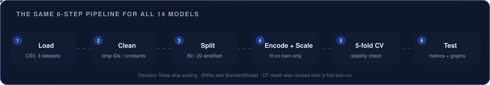
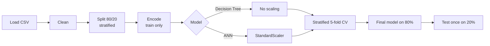
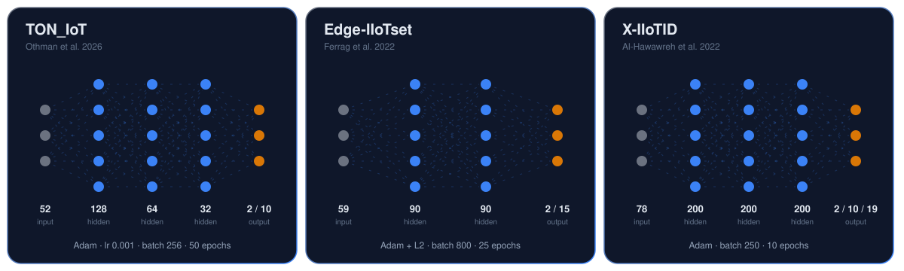
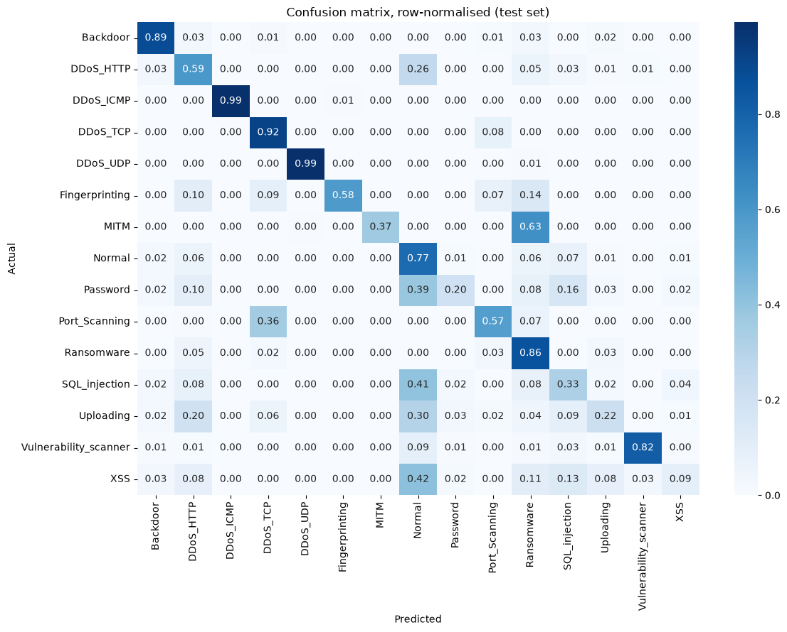
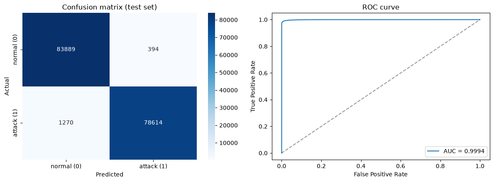
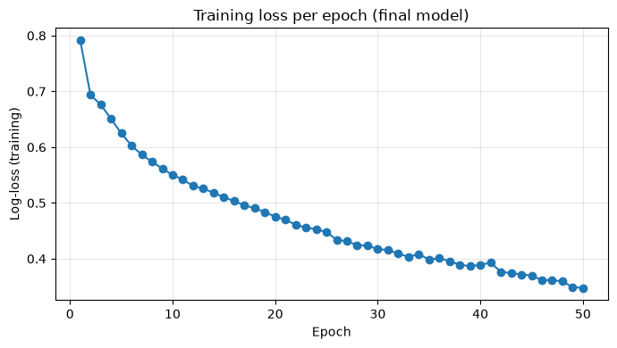
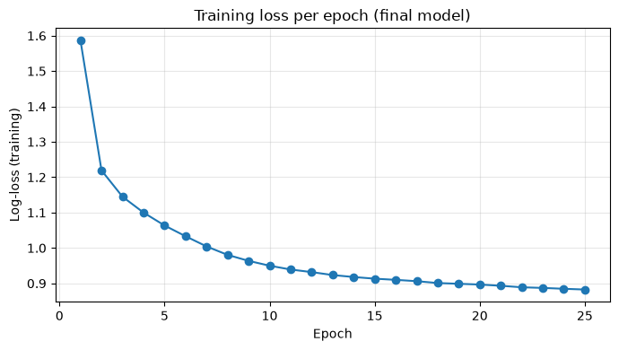

<div align="center">


<br/>


<br/>


<br/><br/>

**Can a machine learning model tell normal IoT network traffic apart from an attack, and name the attack?**
<br/>
This repository answers that with **Decision Trees** and **Artificial Neural Networks**, trained and compared on three public IoT / IIoT security datasets.


<table>
<tr>
<td align="center"><a href="#1-about-the-project">🍂<br/><b>About</b></a></td>
<td align="center"><a href="#2-datasets">🗂️<br/><b>Datasets</b></a></td>
<td align="center"><a href="#3-how-the-pipeline-works">⚙️<br/><b>Pipeline</b></a></td>
<td align="center"><a href="#4-models-and-hyperparameters">🧠<br/><b>Models</b></a></td>
<td align="center"><a href="#5-results">🏆<br/><b>Results</b></a></td>
<td align="center"><a href="#6-graphs">📊<br/><b>Graphs</b></a></td>
<td align="center"><a href="#7-project-structure">📁<br/><b>Structure</b></a></td>
<td align="center"><a href="#8-how-to-run">▶️<br/><b>Run it</b></a></td>
<td align="center"><a href="#9-limitations">⚠️<br/><b>Limits</b></a></td>
</tr>
</table>

</div>


## 🍂 1. About the project

<table>
<tr>
<td width="50%" valign="top">

### 🎯 Goal
Detect attacks in IoT / IIoT network traffic, and name the attack type, using two different model families under **identical conditions**.

### 🎓 Context
1. **Course:** Machine Learning Fundamentals, 6th semester.
2. **Assignment 03:** comparative analysis report.
3. **Team:** 3 students comparing 8 algorithms (ANN, Decision Trees, SVM, Logistic Regression, Naive Bayes, KNN, Random Forest, XGBoost).
4. **This repository:** **Tayyab's part**, which is the Decision Tree and the ANN models, 7 of each.

</td>
<td width="50%" valign="top">

### ✅ Rules followed
| | Rule |
|:-:|---|
| 🔁 | Same split and same preprocessing for every model |
| 🔒 | No tuning on the test set; it is used exactly once |
| 🔢 | Every claim is backed by a number |
| ⚖️ | Class imbalance is measured and discussed |
| ⏱️ | Training and prediction time are reported |

</td>
</tr>
</table>


## 🗂️ 2. Datasets

One model is trained for **each target column**. Binary targets answer *"attack or normal?"*; multiclass targets name the attack type.



| # | Dataset | File | Rows × columns | Targets (classes) | Download |
|:-:|---|---|:-:|---|:-:|
| 1 | 🌐 **TON_IoT** (network subset) | `train_test_network.csv` | 211,043 × 44 | `label` <kbd>2</kbd> · `type` <kbd>10</kbd> | [](https://research.unsw.edu.au/projects/toniot-datasets) |
| 2 | 🏭 **Edge-IIoTset** | `ML-EdgeIIoT-dataset.csv` | 157,800 × 63 | `Attack_label` <kbd>2</kbd> · `Attack_type` <kbd>15</kbd> | [](https://www.kaggle.com/datasets/mohamedamineferrag/edgeiiotset-cyber-security-dataset-of-iot-iiot) |
| 3 | ⚙️ **X-IIoTID** | `X-IIoTID dataset.csv` | 820,834 × 68 | `class3` <kbd>2</kbd> · `class2` <kbd>10</kbd> · `class1` <kbd>19</kbd> | [](https://github.com/Alhawawreh/X-IIoTID) |

> [!NOTE]
> The CSV files are **not stored in this repository**, because they are larger than GitHub allows (the X-IIoTID file is 339 MB; the limit is 100 MB per file). Download them from the links above and place them in the project root. See [How to run](#8-how-to-run).

> [!TIP]
> Because the classes are imbalanced (the rarest X-IIoTID class has only **28 rows**), multiclass scores use **macro averaging**: every class counts equally, so a model cannot look good by only getting the big classes right.


## ⚙️ 3. How the pipeline works

All 14 notebooks follow the **same steps**, so the Decision Tree and the ANN are compared on exactly the same rows.



| Step | What happens | Why |
|:-:|---|---|
| **1** 📥 | **Load** the CSV (path `../../../<file>.csv` from each notebook) | One source of truth per dataset |
| **2** 🧹 | **Clean**: drop IP addresses, ports, timestamps, constant columns, columns > 95% empty (TON_IoT) and raw text payloads (Edge-IIoTset) | Identifiers let a model memorise one capture instead of learning attack behaviour |
| **3** ✂️ | **Split** 80% train / 20% test, stratified on the finest label, `random_state = 42` | Every model of a dataset tests on the same rows |
| **4** 🔤 | **Encode** with one-hot (plus frequency encoding for `dns_query`), learned from the training set only. **ANN only:** `StandardScaler` | No test information leaks into training |
| **5** 🔁 | **Validate** with stratified 5-fold CV on the 80% (64% train / 16% validation per fold) | Checks **stability**; the settings come from papers, so nothing is tuned |
| **6** 🎯 | **Test once** on the 20%: Accuracy, Precision, Recall, F1, ROC-AUC, Log-Loss, FPR, MCC, TP/TN/FP/FN, latency, plus graphs | A fair, single, final measurement |

<details>
<summary><b>🔍 Show the same pipeline as a flowchart</b></summary>
<br/>



</details>

> [!IMPORTANT]
> Duplicates are **kept** (`DEDUPLICATE = False`) because the team has not decided yet. Every notebook has the switch, so the decision can be changed in one line.


## 🧠 4. Models and hyperparameters

Hyperparameters are **taken from published papers for each dataset, not tuned on our data**. Full quotes and caveats are in [`HYPERPARAMETER_SOURCES.md`](HYPERPARAMETER_SOURCES.md).

### 🌳 4.1 Decision Tree (same settings for all 7 models)

```python
DecisionTreeClassifier(criterion="gini", splitter="best", max_depth=None,
                       min_samples_split=2, min_samples_leaf=1, random_state=42)
```

| Dataset | Source paper | Journal |
|---|---|---|
| 🌐 TON_IoT | Dharini et al. (2026) |  |
| 🏭 Edge-IIoTset | Kuo & Wu (2026) | -1F6FEB?style=flat-square) |
| ⚙️ X-IIoTID | Al-Hawawreh et al. (2022) | -00629B?style=flat-square&logo=ieee&logoColor=white) |

### 🧬 4.2 ANN: scikit-learn `MLPClassifier`, one architecture per dataset



| Dataset | Hidden layers | Optimizer | Batch | Epochs | Source |
|---|:-:|:-:|:-:|:-:|---|
| 🌐 TON_IoT | <kbd>128</kbd> → <kbd>64</kbd> → <kbd>32</kbd> | Adam · lr 0.001 | 256 | 50 | :345-4F46E5?style=flat-square) Othman et al. 2026 |
| 🏭 Edge-IIoTset | <kbd>90</kbd> → <kbd>90</kbd> | Adam + L2 | 800 | 25 |  Ferrag et al. 2022 |
| ⚙️ X-IIoTID | <kbd>200</kbd> → <kbd>200</kbd> → <kbd>200</kbd> | Adam *(paper: RMSprop)* | 250 | 10 | -00629B?style=flat-square&logo=ieee&logoColor=white) Al-Hawawreh et al. 2022 |

All ANNs use ReLU activations, a sigmoid (binary) or softmax (multiclass) output, and `random_state = 42`.


## 🏆 5. Results



Test set (20%), measured once. Multiclass F1 is **macro-averaged**.  = Decision Tree,  = ANN.

| # | Dataset · target | Classes | DT accuracy | ANN accuracy | Gap | DT F1 | ANN F1 | Winner |
|:-:|---|:-:|:-:|:-:|:-:|:-:|:-:|:-:|
| 1 | 🌐 TON_IoT · `label` | <kbd>2</kbd> |  |  | 🔻 0.006 | 0.9988 | 0.9949 | 🏆 DT |
| 2 | 🌐 TON_IoT · `type` | <kbd>10</kbd> |  |  | 🔻 0.153 | 0.9495 | 0.7501 | 🏆 DT |
| 3 | 🏭 Edge-IIoTset · `Attack_label` | <kbd>2</kbd> |  |  | 🔻 0.053 | 0.9777 | 0.9490 | 🏆 DT |
| 4 | 🏭 Edge-IIoTset · `Attack_type` | <kbd>15</kbd> |  |  | 🔻 0.193 | 0.8201 | 0.6204 | 🏆 DT |
| 5 | ⚙️ X-IIoTID · `class3` | <kbd>2</kbd> |  |  | 🔻 0.006 | 0.9957 | 0.9895 | 🏆 DT |
| 6 | ⚙️ X-IIoTID · `class2` | <kbd>10</kbd> |  |  | 🔻 0.007 | 0.9806 | 0.9618 | 🏆 DT |
| 7 | ⚙️ X-IIoTID · `class1` | <kbd>19</kbd> |  |  | 🔻 0.007 | 0.9633 | 0.9411 | 🏆 DT |

*Gap = DT accuracy minus ANN accuracy.*

<details>
<summary><b>📐 MCC and Log-Loss (click to open)</b></summary>
<br/>

| Dataset · target | DT MCC | ANN MCC | DT Log-Loss | ANN Log-Loss | Better probabilities |
|---|:-:|:-:|:-:|:-:|:-:|
| 🌐 TON_IoT · `label` | 0.9948 | 0.9786 | 0.0668 | 0.0333 | 🧠 ANN |
| 🌐 TON_IoT · `type` | 0.9732 | 0.8046 | 0.5103 | 0.3640 | 🧠 ANN |
| 🏭 Edge-IIoTset · `Attack_label` | 0.8544 | 0.6083 | 1.3254 | 0.2163 | 🧠 ANN |
| 🏭 Edge-IIoTset · `Attack_type` | 0.8447 | 0.6366 | 4.5661 | 0.8796 | 🧠 ANN |
| ⚙️ X-IIoTID · `class3` | 0.9915 | 0.9798 | 0.1526 | 0.0274 | 🧠 ANN |
| ⚙️ X-IIoTID · `class2` | 0.9931 | 0.9833 | 0.1680 | 0.0316 | 🧠 ANN |
| ⚙️ X-IIoTID · `class1` | 0.9932 | 0.9835 | 0.1699 | 0.0335 | 🧠 ANN |

Lower Log-Loss is better. A full-depth tree outputs only 0 or 1 as probabilities, so every mistake costs it a lot; the ANN gives smoother probabilities.

</details>

<details>
<summary><b>⏱️ Training time and prediction speed (click to open)</b></summary>
<br/>

| Dataset · target | DT train (s) | ANN train (s) | DT latency (ms/sample) | ANN latency (ms/sample) | Faster |
|---|:-:|:-:|:-:|:-:|:-:|
| 🌐 TON_IoT · `label` / `type` | 0.99 / 1.14 | 49.96 / 57.53 | 0.00034 / 0.00110 | 0.00221 / 0.00248 | ⚡ DT |
| 🏭 Edge-IIoTset · `Attack_label` / `Attack_type` | 0.94 / 1.15 | 11.46 / 12.09 | 0.00106 / 0.00072 | 0.00179 / 0.00172 | ⚡ DT |
| ⚙️ X-IIoTID · `class3` / `class2` / `class1` | 44.31 / 45.96 / 30.21 | 116.31 / 131.05 / 141.03 | 0.00109 / 0.00091 / 0.00095 | 0.00257 / 0.00320 / 0.00285 | ⚡ DT |

The X-IIoTID ANN times were measured on a second laptop, so compare them only roughly. Every metric is also in [`Results.xlsx`](Results.xlsx) and [`result.csv`](result.csv).

</details>

### 💡 5.1 What the numbers say

| # | Finding | Evidence |
|:-:|---|---|
| 1 | 🌳 **The Decision Tree wins accuracy on every target** | Gap under 0.007 on TON_IoT `label` and all 3 X-IIoTID targets; 0.053 on Edge-IIoTset `Attack_label`; 0.15 to 0.19 on TON_IoT `type` and Edge-IIoTset `Attack_type` |
| 2 | 🧠 **The ANN gives better probabilities everywhere** | Lower Log-Loss on all 7 targets (for example 0.03 vs 0.15 on X-IIoTID) |
| 3 | ⚙️ **X-IIoTID is the ANN's best dataset** | About 0.99 accuracy on all three targets, no over- or underfitting |
| 4 | 📉 **Three ANNs underfit** | TON_IoT `type` and both Edge-IIoTset targets: train ≈ test accuracy, loss still falling at the last epoch |
| 5 | ⚖️ **Imbalance hurts most on Edge-IIoTset** | The binary ANN flags 54% of normal traffic as attacks (FPR 0.54); 85% of rows are attacks |
| 6 | ⚡ **Trees are much faster** | About 3 to 50× faster to train and 2 to 7× faster to predict |


## 📊 6. Graphs

Every model saves its graphs to `Graphs/<Algorithm>/<Dataset>/<model>/`. Confusion matrices, Decision Tree on the left and ANN on the right:

<details open>
<summary><b>🌐 TON_IoT</b></summary>
<br/>

| 🌳 Decision Tree · `label` | 🧠 ANN · `label` |
|:-:|:-:|
|  |  |
| 🌳 **Decision Tree · `type`** | 🧠 **ANN · `type`** |
|  |  |

</details>

<details>
<summary><b>🏭 Edge-IIoTset</b></summary>
<br/>

| 🌳 Decision Tree · `Attack_label` | 🧠 ANN · `Attack_label` |
|:-:|:-:|
|  |  |
| 🌳 **Decision Tree · `Attack_type`** | 🧠 **ANN · `Attack_type`** |
|  |  |

</details>

<details>
<summary><b>⚙️ X-IIoTID</b></summary>
<br/>

| 🌳 Decision Tree · `class3` | 🧠 ANN · `class3` |
|:-:|:-:|
|  |  |
| 🌳 **Decision Tree · `class2`** | 🧠 **ANN · `class2`** |
|  |  |
| 🌳 **Decision Tree · `class1`** | 🧠 **ANN · `class1`** |
|  |  |

</details>

<details>
<summary><b>📉 ANN training loss curves</b></summary>
<br/>

| 🌐 TON_IoT · `type` | 🏭 Edge-IIoTset · `Attack_type` | ⚙️ X-IIoTID · `class1` |
|:-:|:-:|:-:|
|  |  |  |

A curve that is still going down at the last epoch means the network could have learned more (underfitting).

</details>

<details>
<summary><b>🌳 Decision Tree: top features and first splits</b></summary>
<br/>

| Top 10 features · TON_IoT `type` | First 3 levels of the tree · TON_IoT `type` |
|:-:|:-:|
|  |  |

</details>


## 📁 7. Project structure

```text
Machine-Learning-Project-6th-Semester/
├── 📄 README.md                         ← this page
├── 📦 requirements.txt                  ← Python packages needed to run the notebooks
├── 🎨 assets/                           ← animated SVG components used by this README
│
├── 📓 scripts/
│   ├── Decision Trees/
│   │   ├── TON_IoT/      dt_label.ipynb, dt_type.ipynb
│   │   ├── Edge-IIoT/    dt_label.ipynb, dt_type.ipynb
│   │   └── X-IIoTID/     dt_class3.ipynb, dt_class2.ipynb, dt_class1.ipynb
│   └── ANN/
│       ├── TON_IoT/      ann_label.ipynb, ann_type.ipynb
│       ├── Edge-IIoT/    ann_label.ipynb, ann_type.ipynb
│       └── X-IIoTID/     ann_class3.ipynb, ann_class2.ipynb, ann_class1.ipynb
│
├── 📊 Graphs/
│   ├── Decision Trees/<Dataset>/dt_<target>/    4 PNGs per model
│   └── ANN/<Dataset>/ann_<target>/              3 PNGs per model
│
├── 📈 Results.xlsx · result.csv · Results_backup_before_xiiot_ann.xlsx
│
└── 📜 AUDIT_LOG.md · HYPERPARAMETER_SOURCES.md · ANN_Issues.md
       ANN_Status_Update.md · DT_Status_Update.md · Decision_Tree_Code_Guide.md
```

### 🧭 7.1 What each file is for

| # | Type | File / folder | Purpose |
|:-:|:-:|---|---|
| 1 | 📓 | [`scripts/Decision Trees/`](scripts/Decision%20Trees) | 7 Decision Tree notebooks, one per target: clean, split, validate, train, test, plot. Saved with outputs. |
| 2 | 📓 | [`scripts/ANN/`](scripts/ANN) | 7 ANN notebooks with the same pipeline, plus feature scaling and a loss curve. Saved with outputs. |
| 3 | 📊 | [`Graphs/Decision Trees/`](Graphs/Decision%20Trees) | `01_class_distribution`, `02_confusion_matrix` (binary: `_and_roc`), `03_feature_importance`, `04_tree_top_levels` |
| 4 | 📊 | [`Graphs/ANN/`](Graphs/ANN) | `01_class_distribution`, `02_confusion_matrix` (binary: `_and_roc`), `03_loss_curve` |
| 5 | 📈 | [`Results.xlsx`](Results.xlsx) · [`result.csv`](result.csv) | Every metric for both algorithms: Accuracy, Precision, Recall, F1, ROC-AUC, Log-Loss, FPR, MCC, latency, train and test time, TP/TN/FP/FN |
| 6 | 📈 | [`Results_backup_before_xiiot_ann.xlsx`](Results_backup_before_xiiot_ann.xlsx) | The sheet before our X-IIoTID ANN values replaced earlier ones |
| 7 | 📜 | [`AUDIT_LOG.md`](AUDIT_LOG.md) | Project diary: every decision, the reason, and the exact figures |
| 8 | 📜 | [`HYPERPARAMETER_SOURCES.md`](HYPERPARAMETER_SOURCES.md) | Where each hyperparameter comes from, with quotes from the papers |
| 9 | 📜 | [`ANN_Issues.md`](ANN_Issues.md) | Honest list of ANN problems: underfitting, weak classes, gaps from the papers |
| 10 | 📜 | [`ANN_Status_Update.md`](ANN_Status_Update.md) · [`DT_Status_Update.md`](DT_Status_Update.md) | Short summaries written for teammates |
| 11 | 📜 | [`Decision_Tree_Code_Guide.md`](Decision_Tree_Code_Guide.md) | Explains the Decision Tree code step by step, for learning |
| 12 | 🎨 | [`assets/`](assets) | The 9 animated SVG components on this page |

Each notebook is written as **questions (Q1, Q2, ...) followed by short code cells**, so it reads like a guided walkthrough.


## ▶️ 8. How to run

1. **Clone** the repository:
   ```bash
   git clone https://github.com/tayyabexe/Machine-Learning-Project-6th-Semester.git
   cd Machine-Learning-Project-6th-Semester
   ```
2. **Install** the packages (Python 3.12 or newer):
   ```bash
   pip install -r requirements.txt
   ```
3. **Download the 3 datasets** from the links in [section 2](#2-datasets) and put them in the **project root** with these exact names:
   - `train_test_network.csv`
   - `ML-EdgeIIoT-dataset.csv`
   - `X-IIoTID dataset.csv`
4. **Open a notebook** (for example `scripts/Decision Trees/TON_IoT/dt_label.ipynb`) in Jupyter or VS Code and choose **Run All**.

| Notebooks | ⏱️ Time per notebook |
|---|:-:|
| 🌳 Decision Trees · TON_IoT / Edge-IIoTset | under 1 minute |
| 🌳 Decision Trees · X-IIoTID | 3 to 5 minutes |
| 🧠 ANN · TON_IoT / Edge-IIoTset | 1 to 5 minutes |
| 🧠 ANN · X-IIoTID | 11 to 12 minutes |

> [!WARNING]
> X-IIoTID has 820,834 rows. On machines with 8 GB of RAM or less, run its notebooks **one at a time**.


## ⚠️ 9. Limitations

| # | Limitation | Effect |
|:-:|---|---|
| 1 | 📄 **Paper settings, not tuned settings** | Better settings may exist; tuning would only be allowed on the validation folds |
| 2 | 🧰 **The ANN is scikit-learn's `MLPClassifier`** | No RMSprop and no dropout, so the X-IIoTID optimizer was replaced by Adam |
| 3 | 🧬 **Duplicates are kept** | TON_IoT is 55% duplicates; removing them would change the results |
| 4 | 📚 **Not directly comparable with the papers** | The papers used other splits, SMOTE, feature selection or larger files |
| 5 | 🔍 **Rare classes stay hard** | For example TON_IoT `mitm` (209 test rows) and X-IIoTID `MitM` (23 test rows) |

The full list, with numbers, is in [`ANN_Issues.md`](ANN_Issues.md).


## 📚 10. References

<details>
<summary><b>Show all 5 references</b></summary>
<br/>

1. M. A. Ferrag et al., "Edge-IIoTset: A New Comprehensive Realistic Cyber Security Dataset of IoT and IIoT Applications for Centralized and Federated Learning," *IEEE Access*, vol. 10, pp. 40281–40306, 2022. [doi:10.1109/ACCESS.2022.3165809](https://doi.org/10.1109/ACCESS.2022.3165809)
2. M. Al-Hawawreh, E. Sitnikova, N. Aboutorab, "X-IIoTID: A Connectivity-Agnostic and Device-Agnostic Intrusion Data Set for Industrial Internet of Things," *IEEE Internet of Things Journal*, vol. 9, no. 5, pp. 3962–3977, 2022. [doi:10.1109/JIOT.2021.3102056](https://doi.org/10.1109/JIOT.2021.3102056)
3. N. Dharini, V. S. Janani, J. Katiravan, "Efficient detection of intrusions in TON-IoT dataset using hybrid feature selection approach," *Scientific Reports*, vol. 16, art. 7763, 2026. [doi:10.1038/s41598-026-37834-y](https://doi.org/10.1038/s41598-026-37834-y)
4. C.-W. Kuo, C.-X. Wu, "A Lightweight Two-Stage Intrusion Detection Framework Optimized for Edge-Based IoT Environments," *Computers, Materials & Continua*, vol. 87, no. 3, 2026. [doi:10.32604/cmc.2026.076767](https://doi.org/10.32604/cmc.2026.076767)
5. A. M. H. Othman et al., "A Hybrid CNN–LSTM Model for IoT Intrusion Detection: A Robustness Analysis Across Datasets," *Future Internet*, vol. 18, no. 7, art. 345, 2026. [doi:10.3390/fi18070345](https://doi.org/10.3390/fi18070345)

</details>

<div align="center">


<a href="#top"></a>

<sub>If this project helped you, consider giving it a ⭐</sub>

</div>
