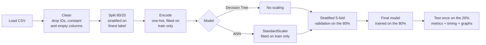
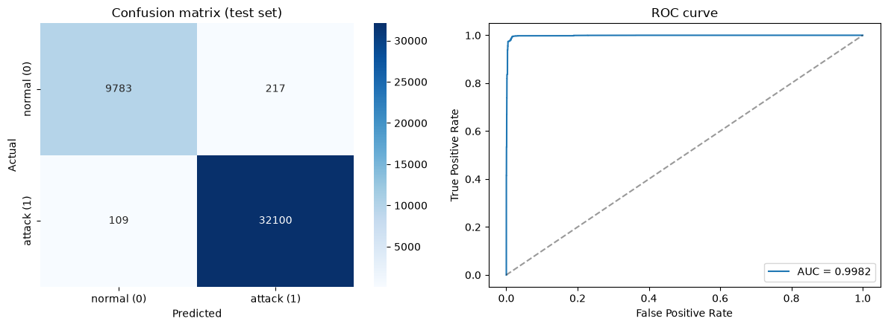
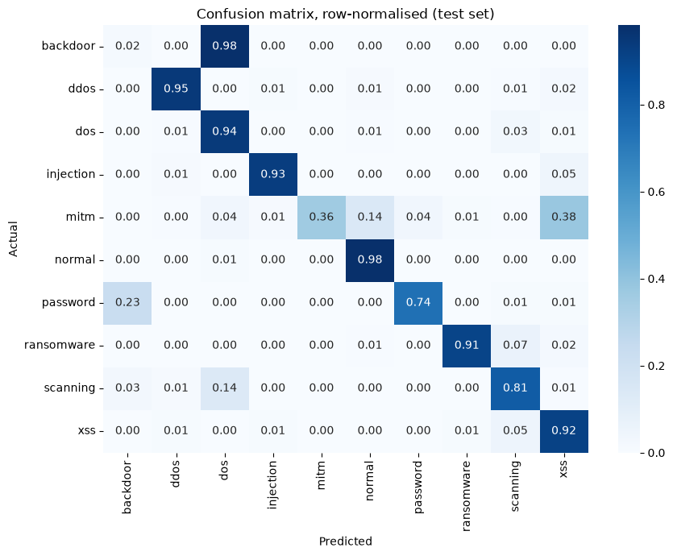
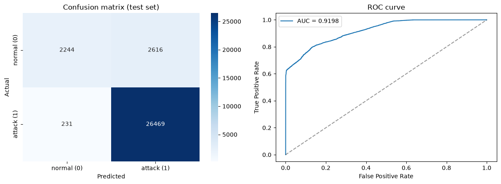
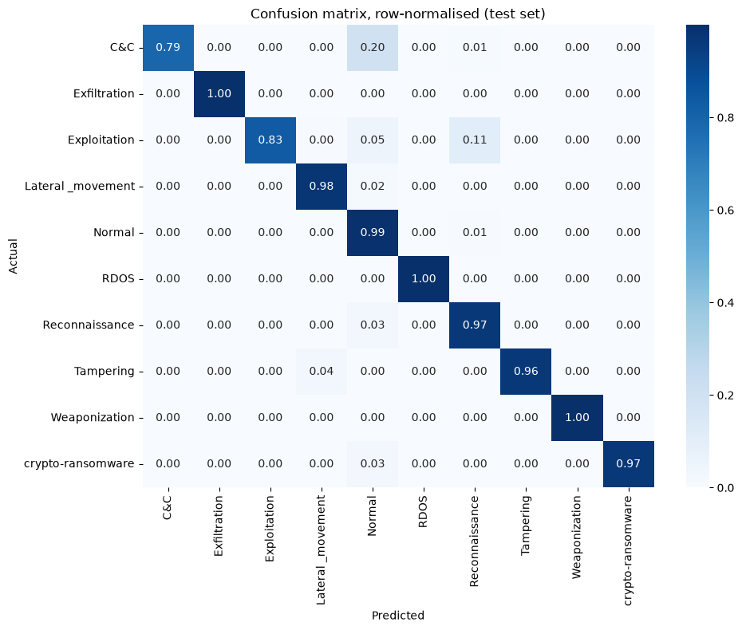
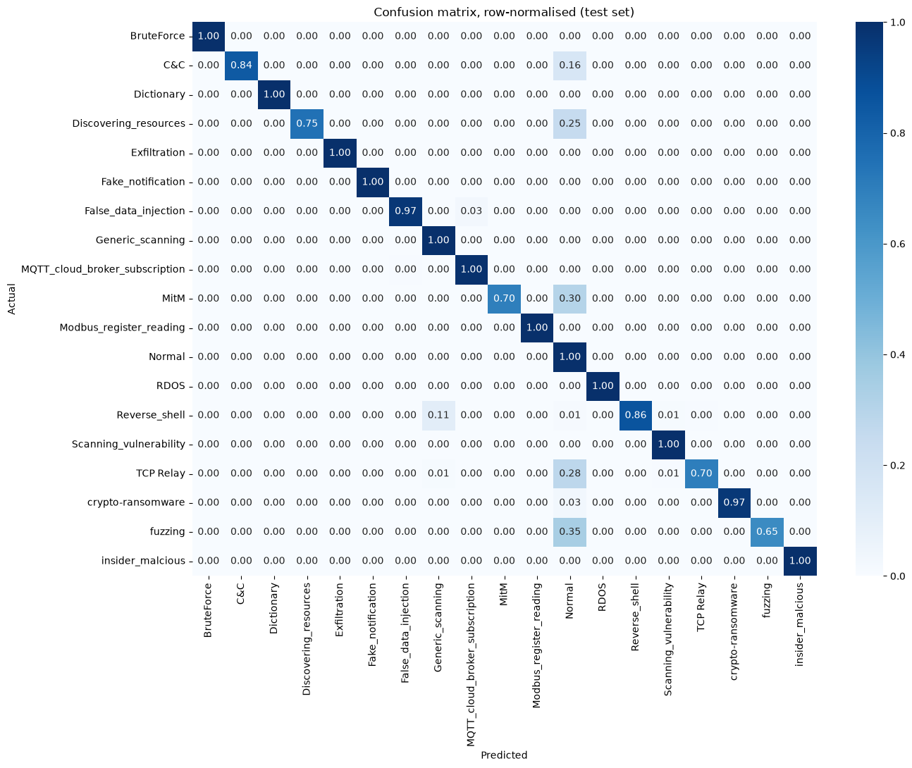
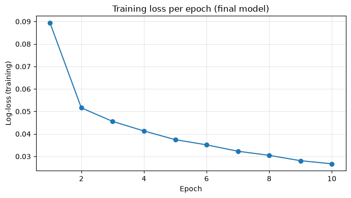

<div align="center">


<br/>


<br/>


<br/><br/>

**Can a machine learning model tell normal IoT network traffic apart from an attack, and name the attack?**
<br/>
This repository answers that with **Decision Trees** and **Artificial Neural Networks**, trained and compared on three public IoT / IIoT security datasets.

[About](#1-about-the-project) · [Datasets](#2-datasets) · [Pipeline](#3-how-the-pipeline-works) · [Models](#4-models-and-hyperparameters) · [Results](#5-results) · [Graphs](#6-graphs) · [Structure](#7-project-structure) · [Run it](#8-how-to-run) · [Limitations](#9-limitations)

</div>


## 1. About the project

1. **Course:** Machine Learning Fundamentals, 6th semester, Assignment 03 (comparative analysis report).
2. **Topic:** supervised intrusion detection, a classification problem on network traffic from IoT and Industrial IoT (IIoT) devices.
3. **Team:** a group of 3 students; the full team compares 8 algorithms (ANN, Decision Trees, SVM, Logistic Regression, Naive Bayes, KNN, Random Forest, XGBoost).
4. **This repository:** contains **Tayyab's part**: the **Decision Tree** and **ANN (multilayer perceptron)** models, 7 of each.
5. **Rules followed** (from the assignment brief):
   - same split and the same preprocessing for every model;
   - no tuning on the test set; the test set is used exactly once;
   - every claim is backed by a number;
   - class imbalance is discussed;
   - training time and prediction time are reported.


## 2. Datasets

One model is trained for **each target column**. Binary targets answer "attack or normal?"; multiclass targets name the attack type.

| # | Dataset | File | Rows × columns | Targets (classes) | Official source |
|---|---|---|---|---|---|
| 1 | **TON_IoT** (network subset) | `train_test_network.csv` | 211,043 × 44 | `label` (2), `type` (10) | [UNSW Canberra](https://research.unsw.edu.au/projects/toniot-datasets) |
| 2 | **Edge-IIoTset** | `ML-EdgeIIoT-dataset.csv` | 157,800 × 63 | `Attack_label` (2), `Attack_type` (15) | [Kaggle (Ferrag et al.)](https://www.kaggle.com/datasets/mohamedamineferrag/edgeiiotset-cyber-security-dataset-of-iot-iiot) |
| 3 | **X-IIoTID** | `X-IIoTID dataset.csv` | 820,834 × 68 | `class3` (2), `class2` (10), `class1` (19) | [GitHub (Al-Hawawreh et al.)](https://github.com/Alhawawreh/X-IIoTID) |

> [!NOTE]
> The CSV files are **not stored in this repository**, because they are larger than GitHub allows (the X-IIoTID file is 339 MB; the limit is 100 MB per file). Download them from the links above and place them in the project root. See [How to run](#8-how-to-run).

<details>
<summary><b>Class imbalance at a glance (click to open)</b></summary>
<br/>

| Dataset | Majority | Rarest class |
|---|---|---|
| TON_IoT | attack 76.3% / normal 23.7% | `mitm`: 1,043 rows (0.5%) |
| Edge-IIoTset | attack 84.6% / normal 15.4% | `Fingerprinting`: 1,001 rows, `MITM`: 1,214 rows |
| X-IIoTID | normal 51.3% / attack 48.7% | `Fake_notification`: 28 rows, `MitM`: 117 rows |

Because of this imbalance, multiclass scores use **macro averaging**: every class counts equally, so a model cannot look good by only getting the big classes right.

</details>


## 3. How the pipeline works

All 14 notebooks follow the **same 10 steps**, so the Decision Tree and the ANN are compared on exactly the same rows.



1. **Load** the CSV (relative path `../../../<file>.csv` from each notebook).
2. **Clean** (dataset-specific):
   - remove identifier columns (IP addresses, ports, timestamps), which would let a model memorise a capture instead of learning attack behaviour;
   - remove constant columns, columns more than 95% empty (TON_IoT only) and raw text payloads (Edge-IIoTset).
3. **Keep duplicates** (`DEDUPLICATE = False`); the switch is in every notebook because the team has not decided yet.
4. **Split** 80% train / 20% test, stratified on the finest label (`type`, `Attack_type`, `class1`), with `random_state = 42`. Every model of a dataset therefore tests on the same rows.
5. **Encode** after the split: one-hot encoding (plus frequency encoding for `dns_query` in TON_IoT), learned from the training set only, so no test information leaks in.
6. **Scale** (ANN only): `StandardScaler` fitted on the training data; refitted inside every fold.
7. **Validate** with stratified 5-fold cross-validation on the 80% (64% train / 16% validation per fold). This checks **stability**, not tuning: the hyperparameters come from published papers.
8. **Train** the final model on the full 80% and time it.
9. **Test** once on the 20%:
   - Accuracy, Precision, Recall, F1, ROC-AUC, Log-Loss, FPR, MCC;
   - TP / TN / FP / FN;
   - inference latency (ms per sample).
10. **Plot** the class distribution, the confusion matrix (plus the ROC curve for binary targets), and then:
    - for Decision Trees: the feature importances and the top of the tree;
    - for the ANN: the training loss curve.


## 4. Models and hyperparameters

Hyperparameters are **taken from published papers for each dataset, not tuned on our data**. Full quotes and caveats are in [`HYPERPARAMETER_SOURCES.md`](HYPERPARAMETER_SOURCES.md).

### 4.1 Decision Tree (same settings for all 7 models)

```python
DecisionTreeClassifier(criterion="gini", splitter="best", max_depth=None,
                       min_samples_split=2, min_samples_leaf=1, random_state=42)
```

| Dataset | Source paper |
|---|---|
| TON_IoT | Dharini et al., *Scientific Reports* 16:7763 (2026) |
| Edge-IIoTset | Kuo & Wu, *Computers, Materials & Continua* 87(3) (2026) |
| X-IIoTID | Al-Hawawreh et al., *IEEE Internet of Things Journal* 9(5) (2022) |

### 4.2 ANN: scikit-learn `MLPClassifier` (settings per dataset)

| Dataset | Hidden layers | Optimizer | Batch | Epochs | Source paper |
|---|---|---|---|---|---|
| TON_IoT | 128 → 64 → 32 | Adam, lr 0.001 | 256 | 50 | Othman et al., *Future Internet* 18(7):345 (2026) |
| Edge-IIoTset | 90 → 90 | Adam + L2 | 800 | 25 | Ferrag et al., *IEEE Access* 10 (2022), Table 9 |
| X-IIoTID | 200 → 200 → 200 | Adam (paper: RMSprop) | 250 | 10 | Al-Hawawreh et al., *IEEE IoT Journal* 9(5) (2022) |

All ANNs use ReLU activations, a sigmoid (binary) or softmax (multiclass) output, and `random_state = 42`.


## 5. Results

Test set (20%), measured once. Multiclass metrics are **macro-averaged**. **Bold** marks the better model per row.

| # | Dataset · target | Classes | DT Accuracy | ANN Accuracy | DT F1 | ANN F1 | DT MCC | ANN MCC |
|---|---|---|---|---|---|---|---|---|
| 1 | TON_IoT · `label` | 2 | **0.9981** | 0.9923 | **0.9988** | 0.9949 | **0.9948** | 0.9786 |
| 2 | TON_IoT · `type` | 10 | **0.9766** | 0.8232 | **0.9495** | 0.7501 | **0.9732** | 0.8046 |
| 3 | Edge-IIoTset · `Attack_label` | 2 | **0.9623** | 0.9098 | **0.9777** | 0.9490 | **0.8544** | 0.6083 |
| 4 | Edge-IIoTset · `Attack_type` | 15 | **0.8573** | 0.6645 | **0.8201** | 0.6204 | **0.8447** | 0.6366 |
| 5 | X-IIoTID · `class3` | 2 | **0.9958** | 0.9899 | **0.9957** | 0.9895 | **0.9915** | 0.9798 |
| 6 | X-IIoTID · `class2` | 10 | **0.9953** | 0.9887 | **0.9806** | 0.9618 | **0.9931** | 0.9833 |
| 7 | X-IIoTID · `class1` | 19 | **0.9953** | 0.9886 | **0.9633** | 0.9411 | **0.9932** | 0.9835 |

<details>
<summary><b>Training time and prediction speed (click to open)</b></summary>
<br/>

| Dataset · target | DT train (s) | ANN train (s) | DT latency (ms/sample) | ANN latency (ms/sample) |
|---|---|---|---|---|
| TON_IoT · `label` / `type` | 0.99 / 1.14 | 49.96 / 57.53 | 0.00034 / 0.00110 | 0.00221 / 0.00248 |
| Edge-IIoTset · `Attack_label` / `Attack_type` | 0.94 / 1.15 | 11.46 / 12.09 | 0.00106 / 0.00072 | 0.00179 / 0.00172 |
| X-IIoTID · `class3` / `class2` / `class1` | 44.31 / 45.96 / 30.21 | 116.31 / 131.05 / 141.03 | 0.00109 / 0.00091 / 0.00095 | 0.00257 / 0.00320 / 0.00285 |

The X-IIoTID ANN times were measured on a second laptop, so compare them only roughly. All other metrics (ROC-AUC, Log-Loss, FPR, TP/TN/FP/FN) are in [`Results.xlsx`](Results.xlsx) and [`result.csv`](result.csv).

</details>

### 5.1 What the numbers say

1. **The Decision Tree wins on every target.** The gap is small on binary tasks and on X-IIoTID (under 1 percentage point), and large on TON_IoT `type` and Edge-IIoTset.
2. **X-IIoTID is the ANN's best dataset:** about 0.99 on all three targets. Its Log-Loss is also 5 times lower than the tree's (0.03 vs 0.15), so its probability estimates are better.
3. **Three ANNs underfit:** TON_IoT `type` and both Edge-IIoTset targets. Train accuracy ≈ test accuracy, and the loss was still falling at the last epoch, so the epoch counts from the papers are too few for this setup.
4. **Imbalance hurts most on Edge-IIoTset:** the binary ANN flags 54% of normal traffic as attacks (FPR 0.54), because 85% of the rows are attacks.
5. **Speed:** trees train about 3 to 50 times faster and predict about 2 to 7 times faster than the ANNs.


## 6. Graphs

Every model saves its graphs to `Graphs/<Algorithm>/<Dataset>/<model>/`. Confusion matrices for each target, Decision Tree on the left and ANN on the right:

<details open>
<summary><b>TON_IoT</b></summary>
<br/>

| Decision Tree · `label` | ANN · `label` |
|---|---|
|  |  |
| **Decision Tree · `type`** | **ANN · `type`** |
|  |  |

</details>

<details>
<summary><b>Edge-IIoTset</b></summary>
<br/>

| Decision Tree · `Attack_label` | ANN · `Attack_label` |
|---|---|
|  |  |
| **Decision Tree · `Attack_type`** | **ANN · `Attack_type`** |
|  |  |

</details>

<details>
<summary><b>X-IIoTID</b></summary>
<br/>

| Decision Tree · `class3` | ANN · `class3` |
|---|---|
|  |  |
| **Decision Tree · `class2`** | **ANN · `class2`** |
|  |  |
| **Decision Tree · `class1`** | **ANN · `class1`** |
|  |  |

</details>

<details>
<summary><b>Training loss curves (ANN)</b></summary>
<br/>

| TON_IoT · `type` | Edge-IIoTset · `Attack_type` | X-IIoTID · `class1` |
|---|---|---|
|  |  |  |

A curve that is still going down at the last epoch means the network could have learned more (underfitting).

</details>


## 7. Project structure

```text
Machine-Learning-Project-6th-Semester/
├── README.md                          ← this page
├── requirements.txt                   ← Python packages needed to run the notebooks
├── assets/                            ← animated SVG banners used by this README
│
├── scripts/
│   ├── Decision Trees/
│   │   ├── TON_IoT/      dt_label.ipynb, dt_type.ipynb
│   │   ├── Edge-IIoT/    dt_label.ipynb, dt_type.ipynb
│   │   └── X-IIoTID/     dt_class3.ipynb, dt_class2.ipynb, dt_class1.ipynb
│   └── ANN/
│       ├── TON_IoT/      ann_label.ipynb, ann_type.ipynb
│       ├── Edge-IIoT/    ann_label.ipynb, ann_type.ipynb
│       └── X-IIoTID/     ann_class3.ipynb, ann_class2.ipynb, ann_class1.ipynb
│
├── Graphs/
│   ├── Decision Trees/<Dataset>/dt_<target>/    4 PNGs per model
│   └── ANN/<Dataset>/ann_<target>/              3 PNGs per model
│
├── Results.xlsx                       ← team results sheet (DT + ANN rows filled)
├── result.csv                         ← same sheet as CSV
├── Results_backup_before_xiiot_ann.xlsx
│
├── AUDIT_LOG.md                       ← every decision and number, step by step
├── HYPERPARAMETER_SOURCES.md          ← papers, quotes and caveats for every setting
├── ANN_Issues.md                      ← known problems and limitations of the ANN
├── ANN_Status_Update.md               ← ANN summary for teammates
├── DT_Status_Update.md                ← Decision Tree summary for teammates
└── Decision_Tree_Code_Guide.md        ← step-by-step explanation of the DT code
```

### 7.1 What each file is for

| # | File / folder | Purpose |
|---|---|---|
| 1 | `scripts/Decision Trees/**/dt_*.ipynb` | 7 Decision Tree notebooks, one per target. Each one cleans, splits, validates, trains, tests and plots. Saved with outputs. |
| 2 | `scripts/ANN/**/ann_*.ipynb` | 7 ANN notebooks with the same pipeline, plus feature scaling and a loss curve. Saved with outputs. |
| 3 | `Graphs/Decision Trees/...` | `01_class_distribution`, `02_confusion_matrix` (binary: `_and_roc`), `03_feature_importance`, `04_tree_top_levels`. |
| 4 | `Graphs/ANN/...` | `01_class_distribution`, `02_confusion_matrix` (binary: `_and_roc`), `03_loss_curve`. |
| 5 | `Results.xlsx` / `result.csv` | All metrics for both algorithms: Accuracy, Precision, Recall, F1, ROC-AUC, Log-Loss, FPR, MCC, latency, train and test time, TP/TN/FP/FN. |
| 6 | `Results_backup_before_xiiot_ann.xlsx` | The sheet before our X-IIoTID ANN values replaced the earlier ones. Kept for reference. |
| 7 | `AUDIT_LOG.md` | The project diary: every decision, the reason for it, and the exact figures. |
| 8 | `HYPERPARAMETER_SOURCES.md` | Where every hyperparameter comes from, with quotes from the papers. |
| 9 | `ANN_Issues.md` | Honest list of ANN problems: underfitting, weak classes, gaps from the papers. |
| 10 | `ANN_Status_Update.md`, `DT_Status_Update.md` | Short summaries written for teammates. |
| 11 | `Decision_Tree_Code_Guide.md` | Explains the Decision Tree code line by line, for learning. |

Each notebook is written as **questions (Q1, Q2, ...) followed by short code cells**, so it reads like a guided walkthrough.


## 8. How to run

1. **Clone** the repository:
   ```bash
   git clone https://github.com/tayyabexe/Machine-Learning-Project-6th-Semester.git
   cd Machine-Learning-Project-6th-Semester
   ```
2. **Install** the packages (Python 3.12 or newer):
   ```bash
   pip install -r requirements.txt
   ```
3. **Download the 3 datasets** from the links in [section 2](#2-datasets) and put them in the **project root** with these exact names:
   - `train_test_network.csv`
   - `ML-EdgeIIoT-dataset.csv`
   - `X-IIoTID dataset.csv`
4. **Open a notebook** (for example `scripts/Decision Trees/TON_IoT/dt_label.ipynb`) in Jupyter or VS Code and choose **Run All**.
5. **Expected run times** on a normal laptop (12 threads):

   | Notebooks | Time per notebook |
   |---|---|
   | Decision Trees, TON_IoT / Edge-IIoTset | under 1 minute |
   | Decision Trees, X-IIoTID | 3 to 5 minutes |
   | ANN, TON_IoT / Edge-IIoTset | 1 to 5 minutes |
   | ANN, X-IIoTID | 11 to 12 minutes (run one at a time on machines with 8 GB RAM or less) |


## 9. Limitations

1. **Paper settings, not tuned settings.** Results show how the published settings behave on our split; better settings may exist (tuning would only be allowed on the validation folds).
2. **The ANN is scikit-learn's `MLPClassifier`.** It has no RMSprop and no dropout, so the X-IIoTID optimizer was replaced by Adam.
3. **Duplicates are kept.** TON_IoT is 55% duplicates; removing them would change the results, and the team has not decided yet.
4. **Results are not directly comparable with the papers.** The papers used other splits, SMOTE, feature selection or larger files.
5. **Rare classes stay hard.** Examples: TON_IoT `mitm` (209 test rows), X-IIoTID `MitM` (23 test rows).

The full list, with numbers, is in [`ANN_Issues.md`](ANN_Issues.md).


## 10. References

1. M. A. Ferrag et al., "Edge-IIoTset: A New Comprehensive Realistic Cyber Security Dataset of IoT and IIoT Applications for Centralized and Federated Learning," *IEEE Access*, vol. 10, pp. 40281–40306, 2022. [doi:10.1109/ACCESS.2022.3165809](https://doi.org/10.1109/ACCESS.2022.3165809)
2. M. Al-Hawawreh, E. Sitnikova, N. Aboutorab, "X-IIoTID: A Connectivity-Agnostic and Device-Agnostic Intrusion Data Set for Industrial Internet of Things," *IEEE Internet of Things Journal*, vol. 9, no. 5, pp. 3962–3977, 2022. [doi:10.1109/JIOT.2021.3102056](https://doi.org/10.1109/JIOT.2021.3102056)
3. N. Dharini, V. S. Janani, J. Katiravan, "Efficient detection of intrusions in TON-IoT dataset using hybrid feature selection approach," *Scientific Reports*, vol. 16, art. 7763, 2026. [doi:10.1038/s41598-026-37834-y](https://doi.org/10.1038/s41598-026-37834-y)
4. C.-W. Kuo, C.-X. Wu, "A Lightweight Two-Stage Intrusion Detection Framework Optimized for Edge-Based IoT Environments," *Computers, Materials & Continua*, vol. 87, no. 3, 2026. [doi:10.32604/cmc.2026.076767](https://doi.org/10.32604/cmc.2026.076767)
5. A. M. H. Othman et al., "A Hybrid CNN–LSTM Model for IoT Intrusion Detection: A Robustness Analysis Across Datasets," *Future Internet*, vol. 18, no. 7, art. 345, 2026. [doi:10.3390/fi18070345](https://doi.org/10.3390/fi18070345)

<div align="center">


<sub>If this project helped you, consider giving it a ⭐</sub>

</div>
